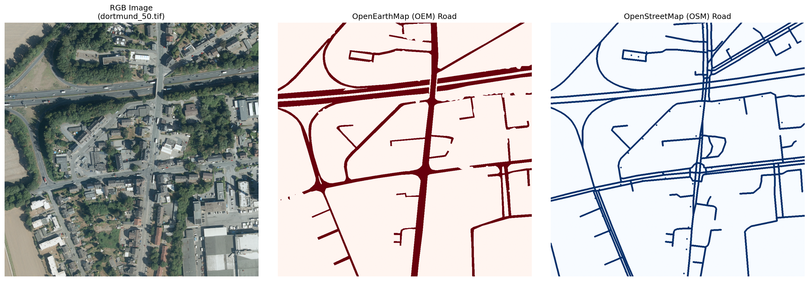
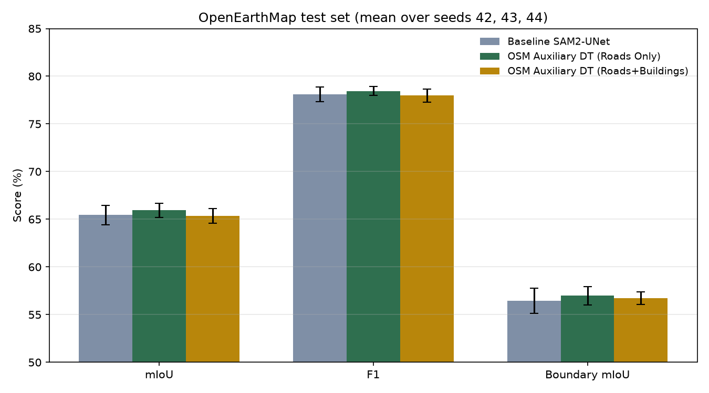
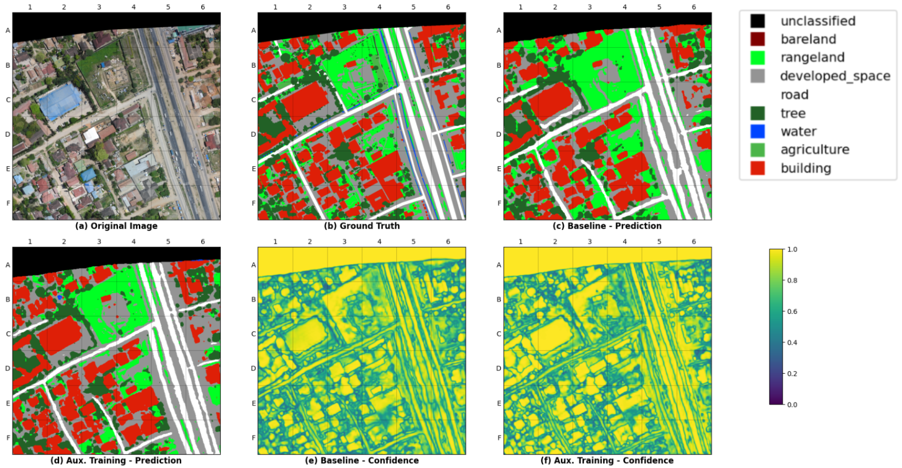

# SAM2-UNet with OpenStreetMap auxiliary supervision

This repository contains the code and results for the thesis
*Adapting SAM2-UNet for LULC Semantic Segmentation* and the EPIA 2026
paper on high-resolution land use / land cover semantic segmentation:
*"Adapting SAM2-UNet for High-Resolution LULC Semantic Segmentation with
OpenStreetMap Auxiliary Supervision"*.

The model adapts SAM2-UNet (SAM2 Hiera-tiny encoder + receptive-field blocks +
one shared decoder) with separate semantic and auxiliary projections. It is
trained on [OpenEarthMap](#data). The auxiliary projections are supervised
during training with OpenStreetMap-derived road and
building masks used as distance-transform soft targets (MSE loss, `lambda_road
= 0.5`, `lambda_building = 0.25`, max distance `d = 6`). The auxiliary head
outputs 2 channels (channel 0 = roads, channel 1 = buildings). At inference
time the auxiliary projections are skipped, so the model runs on RGB imagery only.
The RGB input has 3 channels; the semantic output has 9 OEM classes, including
unclassified (class 0). Only label 255 is ignored. The 2 or 4 auxiliary
channels are separate from these semantic classes.

## Repository contents

```
├── src/
│   ├── __init__.py
│   ├── checkpoints.py  # Checkpoint loading and channel detection
│   ├── model.py        # DualDecoder_SAM2UNet: frozen SAM2 encoder, adapters, RFB blocks, shared decoder, separate projections
│   ├── dataset.py      # OpenEarthMap tiles + OSM road/building mask loading and augmentation
│   └── metrics.py      # mIoU, precision/recall, F1, per-class IoU, Boundary IoU
├── scripts/
│   ├── train.py                  # Baseline + auxiliary training runs over multiple seeds
│   ├── evaluate.py               # Evaluate a trained checkpoint on the test split
│   ├── predict.py                # Single-image inference -> indexed PNG
│   ├── predict_large_tif.py      # Sliding-window inference on large geoTIFFs (UAV orthomosaics)
│   ├── aggregate_metrics.py      # Mean/std over seed metrics JSONs (produces the results table)
│   ├── plot_results.py           # Charts from aggregated metrics
│   └── profile_model.py          # Forward latency and parameter counts
├── data/splits/                  # Exact train/val/test split files (1879 / 404 / 404 tiles)
├── osm_prep/                     # OpenStreetMap road/building mask rasterisation pipeline
├── notebooks/                    # Notebook entry points for the training scripts
├── figures/                      # Figures referenced below
└── results/
    ├── history/                  # Per-seed test metrics (seeds 42, 43, 44)
    ├── historical/               # Additional saved experiment results
    ├── index.json                # Result paths, seeds and source versions
    └── test_comparison.png
```

The modules in `src/` and `scripts/` are adapted from the training notebooks.
The runnable notebooks call these modules; saved historical results retain
their source versions in [results/index.json](results/index.json). The figure
below shows how rasterised OSM road masks align with the OpenEarthMap annotations.



## Notebooks

- `notebooks/train_paper_models_seeds42-44.ipynb` trains all five
  configurations (baseline, roads only at lambda 0.5, roads+buildings at
  lambda_building 0.25/0.50/0.75) over seeds 42, 43 and 44. It writes one
  `{run}_seed{seed}_metrics.json` and one `{run}_seed{seed}_final.pth` per run;
  edit the paths and seed list in the configuration cell before running.
- `notebooks/dt_ablation_lambda0p5_d3-6-10.ipynb` contains the distance-transform
  ablation on the validation split (d = 3, 6, 10 at lambda 0.5), plus the
  no-OSM baseline.
- `notebooks/buildings_only_bce_dice.ipynb` runs both buildings-only weights.
- `notebooks/building_weight_validation_sweep.ipynb` sweeps building BCE+Dice
  weights with road DT-MSE fixed at 0.5.
- `notebooks/four_class_auxiliary.ipynb` runs the DT-MSE and mixed-loss variants.

The notebooks contain no saved outputs. Historical evaluations are available
under `results/` and are separate from new training runs.

## Setup

```bash
pip install -r requirements.txt
pip install git+https://github.com/facebookresearch/sam2.git@2b90b9f5ceec907a1c18123530e92e794ad901a4
```

The SAM2 revision above comes from a saved installation log; the training
notebooks did not pin it. Use compatible PyTorch/torchvision builds and an
Albumentations version with `Compose.set_random_seed`. The requirements are
minimum dependencies, not a tested environment lockfile.

You also need the SAM2 tiny encoder checkpoint (`sam2_hiera_tiny.pt`) from the
[SAM2 releases](https://github.com/facebookresearch/sam2), e.g.:

```bash
wget https://dl.fbaipublicfiles.com/segment_anything_2/072824/sam2_hiera_tiny.pt
```

## Data

The model is trained and evaluated on **OpenEarthMap** (excluding the xBD
subset), organised as `<city>/images/*.tif` and `<city>/labels/*.tif`. You can
obtain it from:

- our Kaggle copy: https://www.kaggle.com/datasets/tiagosantos71921/openearthmap-thesis
- the official release: https://open-earth-map.org/ (also on Zenodo, https://zenodo.org/records/7223446)

The train / validation / test tile lists used by the public scripts are in
`data/splits/` (`train.txt` 1879 tiles, `val.txt` 404, `test.txt` 404), one
tile name per line. Historical split versions are recorded in the results index.

### OSM auxiliary labels

Rasterised binary road (``_highway_mask.tif``) and building
(``_building_mask.tif``) masks aligned to the tiles are needed only for the
auxiliary training runs. Two options:

1. **Download pre-generated masks** from our Kaggle dataset
   (includes the per-tile metadata CSVs):
   https://www.kaggle.com/datasets/tiagosantos71921/openstreetmap
2. **Generate them yourself** with the rasterisation pipeline in
   [`osm_prep/`](osm_prep/README.md) (OSM tags `highway=*` / `building=*`,
   roads dilated after rasterisation, per-tile UTM grids). See its
   README for the exact commands.

## Training

```bash
python scripts/train.py \
    --data-root /path/to/OpenEarthMap_wo_xBD \
    --train-txt data/splits/train.txt --val-txt data/splits/val.txt --test-txt data/splits/test.txt \
    --osm-roads-dir /path/to/osm/roads/binary_masks \
    --osm-buildings-dir /path/to/osm/buildings/binary_masks \
    --sam-checkpoints-dir /path/to/sam-checkpoints \
    --seeds 42 43 44 --evaluate-test
```

Training uses AdamW (lr 1e-3, weight decay 5e-4), a cosine schedule, batch
size 4 on 512x512 tiles, mixed precision, and early stopping on validation
mIoU. Each run's best checkpoint is saved as `{run}_seed{seed}_final.pth`
under `outputs/`, and its validation and optional test metrics under `history/`.
Test evaluation requires `--evaluate-test` and `--test-txt`. For validation-only
runs, omit both and use `--validation-only`.

Use `--experiments NAME [NAME ...]` to select runs; the default five are unchanged.

| Name | Auxiliary losses |
| --- | --- |
| `baseline` | OEM only |
| `roads_only_L0p5` | Road: 0.5 x DT-MSE |
| `roads_bldg_L0p25`, `roads_bldg_L0p5`, `roads_bldg_L0p75` | Road: 0.5 x DT-MSE; building: named weight x DT-MSE |
| `roads_bldg_L0p25_bce_dice`, `roads_bldg_L0p5_bce_dice`, `roads_bldg_L0p75_bce_dice` | Road: 0.5 x DT-MSE; building: named weight x BCE+Dice |
| `bldg_only_L0p25_bce_dice` | Building: 0.25 × BCE+Dice |
| `bldg_only_L0p5_bce_dice` | Building: 0.50 × BCE+Dice |
| `four_class_L0p5_d6_dt_mse` | Road/building/water/tree: 0.50 × DT-MSE each, d=6 |
| `four_class_L0p5_d6_mixed` | Same weights; building uses BCE+Dice, others DT-MSE |

Four-class runs require `--osm-water-dir` and `--osm-trees-dir`, each pointing
to its mask directory. Auxiliary channels are road=0, building=1, water=2,
tree=3; other runs retain two channels. BCE+Dice weights both terms equally,
uses Dice smoothing of 1e-6, and excludes invalid supervision. These
configurations are not verified reproductions of historical runs.
Use a new `--work-dir` if run outputs already exist.

For example, add `--experiments bldg_only_L0p25_bce_dice bldg_only_L0p5_bce_dice`
to the training command to run the two buildings-only models. For four-class
training, use `--experiments four_class_L0p5_d6_dt_mse four_class_L0p5_d6_mixed`
and supply the water and tree directories.

### Validation sweeps

`--dt-max-distance` sets the clipping distance in resized-mask pixels (default
6). Non-default distances have separate output names. This Bash example runs
d=3, 6 and 10 without loading or evaluating a test split:

```bash
for d in 3 6 10; do
    python scripts/train.py \
        --data-root /path/to/OpenEarthMap_wo_xBD \
        --train-txt data/splits/train.txt --val-txt data/splits/val.txt \
        --osm-roads-dir /path/to/osm/roads/binary_masks \
        --sam-checkpoints-dir /path/to/sam-checkpoints \
        --work-dir ./distance_sweep --seeds 42 43 44 \
        --experiments roads_only_L0p5 --dt-max-distance "$d" --validation-only
done
```

For the building-weight sweep, select the three `roads_bldg_*_bce_dice` names
listed above and provide both road and building mask directories.

## Evaluation

```bash
python scripts/evaluate.py \
    --data-root /path/to/OpenEarthMap_wo_xBD \
    --split-txt data/splits/test.txt \
    --sam-checkpoint /path/to/sam2_hiera_tiny.pt \
    --weights /path/to/roads_bldg_L0p25_seed42_final.pth \
    --output evaluation.json
```

Prints mIoU, F1, precision/recall, Boundary IoU, road IoU and the per-class
IoU breakdown, using the same evaluation function as training. The JSON also
records checkpoint/split hashes, configuration and metric settings. Class 0
is included in the nine-class macro averages; absent classes score zero.
For validation, use `--split val --split-txt data/splits/val.txt`.

## Prediction

Single image (any format, resized to 512 and ImageNet-normalised):

```bash
python scripts/predict.py \
    --image /path/to/image.tif \
    --sam-checkpoint /path/to/sam2_hiera_tiny.pt \
    --weights /path/to/roads_bldg_L0p25_seed42_final.pth \
    --output prediction.png
```

Large geoTIFF (e.g. a UAV / drone orthomosaic). The target resolution defaults
to 0.50 metres per model-input pixel, so a 512-pixel tile covers 256 metres.
Overlapping tiles are stitched and exported as an indexed PNG and a class
GeoTIFF. Training resizes each tile to 512 pixels; its effective GSD can vary.

```bash
python scripts/predict_large_tif.py \
    --tif /path/to/uav_orthomosaic.tif \
    --sam-checkpoint /path/to/sam2_hiera_tiny.pt \
    --weights /path/to/roads_bldg_L0p25_seed42_final.pth \
    --target-gsd 0.50 --output uav_prediction
```

The GeoTIFF keeps the source CRS and upper-left origin, with pixels at the
target GSD and dimensions rounded up to cover the source. Nodata is 255,
distinct from class 0. Edge tiles are padded without stretching. Input must be
uint8/uint16 RGB with a projected CRS and a north-up transform; degrees or
missing spatial metadata are rejected. `--resolution` checks the native GSD
against the metadata. Add `--preview` for an RGB/prediction figure.

## Results

Saved OpenEarthMap test results, mean +/- population std (ddof=0) over seeds 42, 43, 44:

| Model | mIoU | F1 | Boundary mIoU |
|---|---|---|---|
| Baseline SAM2-UNet | 0.6545 +/- 0.0101 | 0.7811 +/- 0.0075 | 0.5643 +/- 0.0132 |
| OSM Auxiliary DT (Roads Only) | **0.6594 +/- 0.0074** | **0.7846 +/- 0.0049** | **0.5698 +/- 0.0095** |
| OSM Auxiliary DT (Roads+Buildings) | 0.6536 +/- 0.0076 | 0.7797 +/- 0.0070 | 0.5675 +/- 0.0065 |

To reproduce these numbers from the metric files:

```bash
python scripts/aggregate_metrics.py --stage test --ddof 0 \
    --family sam2unet-train-kaggle-paper-models --output test_summary.json
```

To plot the aggregated results:

```bash
python scripts/plot_results.py --summary test_summary.json --output test_comparison.png
```



Distance-transform ablation (validation split): the d=6 setting gives the best
validation behaviour (mIoU 0.6777, Boundary mIoU 0.5727, Road IoU 0.5777)
compared with d=3, d=10, and the no-OSM baseline in that run. See the saved
histories and source notes in [results/README.md](results/README.md).

The qualitative figure below contrasts baseline predictions with the
roads-only auxiliary model.



Aggregation also supports `--stage val` (saved final validation), `--stage best-val` (selected validation summary) and `--ddof 1` (sample std). Use
`--history-dir /path/to/run/history` for new runs. Historical families, splits
and seed identities are kept separate; see [results/README.md](results/README.md).

## Runtime profiling

```bash
python scripts/profile_model.py \
    --sam-checkpoint /path/to/sam2_hiera_tiny.pt --weights /path/to/model.pth \
    --device cuda --precision fp16 --size 512 --batch-size 1 \
    --warmup 50 --iterations 300 --path semantic --output profile.json
```

This measures forward latency only, excluding file IO, preprocessing, transfers
and export. `--path dual` includes the auxiliary projections. Parameter counts
report registered and `requires_grad` parameters, not how many participate in
the forward computation. Measure the chosen checkpoint and path directly when
comparing runtime.

## Pre-trained weights

Trained checkpoints are available for download:
https://github.com/tiagosantos63390/SAM2-UNet-OSM-LULC/releases

This is the `roads_bldg_L0p25` (roads+buildings, lambda_building = 0.25,
d = 6) configuration. Its exact seed/epoch association is not recorded.
Weights are a plain `state_dict` for `DualDecoder_SAM2UNet` (trained with a 2-channel OSM auxiliary
head); load them with `evaluate.py` / `predict.py` / `predict_large_tif.py`
with the corresponding SAM2 backbone checkpoint. The loaders detect 2-, 3- or
4-channel auxiliary projections and load all weights strictly. Historical
3-channel heads use unused=0, road=1, building=2; current heads use the layouts
listed above. Plain state dictionaries, `state_dict`/`model_state_dict` wrappers
and a uniform `module.` prefix are supported.

## Citation

Tiago Santos, Oraib Almegdadi, João Manso and Nuno C. Marques.
"Adapting SAM2-UNet for High-Resolution LULC Semantic Segmentation with
OpenStreetMap Auxiliary Supervision." *Progress in Artificial Intelligence*,
EPIA 2026, Lecture Notes in Computer Science, Springer, 2026. Listed as
"To appear" in the submitted thesis; no DOI is supplied there.

## License

The code in this repository is released under the
[Apache License 2.0](LICENSE).

## Acknowledgments

This work builds on the following open-source projects and datasets:

- **SAM 2**: N. Ravi, V. Gabeur, Y.-T. Hu, et al., "SAM 2: Segment Anything in
  Images and Videos", *arXiv:2408.00714*, 2024.
  Code: https://github.com/facebookresearch/sam2 (Apache-2.0)
- **SAM2-UNet**: X. Xiong, Z. Wu, S. Tan, et al., "SAM2-UNet: Segment Anything
  2 Makes Strong Encoder for Natural and Medical Image Segmentation",
  *arXiv:2408.08870*, 2024.
  Code: https://github.com/WZH0120/SAM2-UNet (Apache-2.0)
- **OpenEarthMap**: J. Xia, N. Yokoya, B. Adriano, et al., "OpenEarthMap: A
  Benchmark Dataset for Global High-Resolution Land Cover Mapping", *WACV*
  2023. Dataset: https://open-earth-map.org/ (CC-BY-4.0)
- **OpenStreetMap**: OpenStreetMap contributors, spatially referenced from
  OSMnx queries of the live OSM database. See M. Haklay and P. Weber,
  "OpenStreetMap: User-Generated Street Maps", *IEEE Pervasive Computing* 7(4),
  2008. https://www.openstreetmap.org (ODbL)

Follow the source-specific imagery terms supplied with OpenEarthMap. The code
license does not extend to datasets or third-party imagery.
