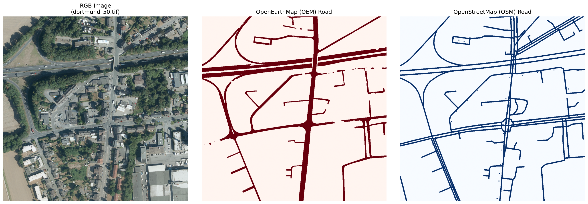
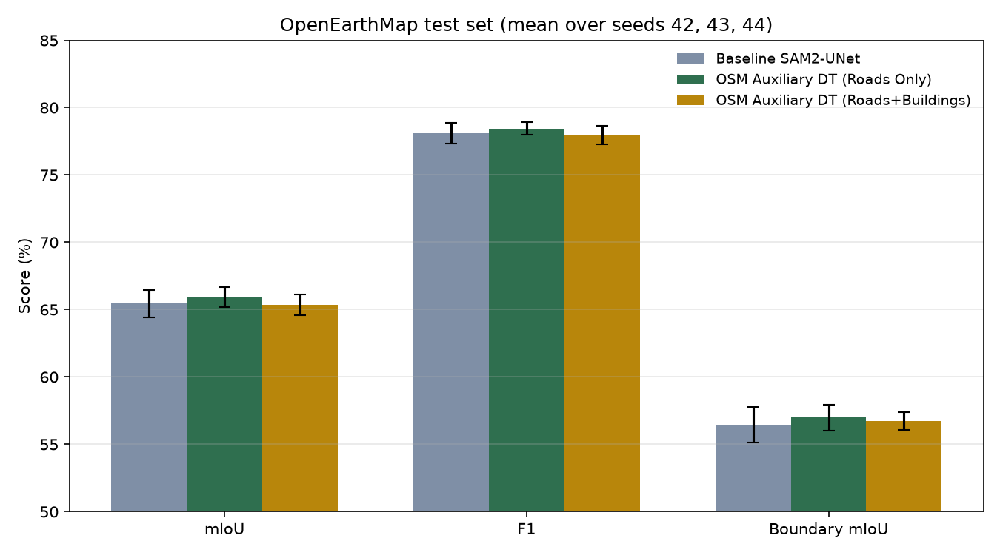
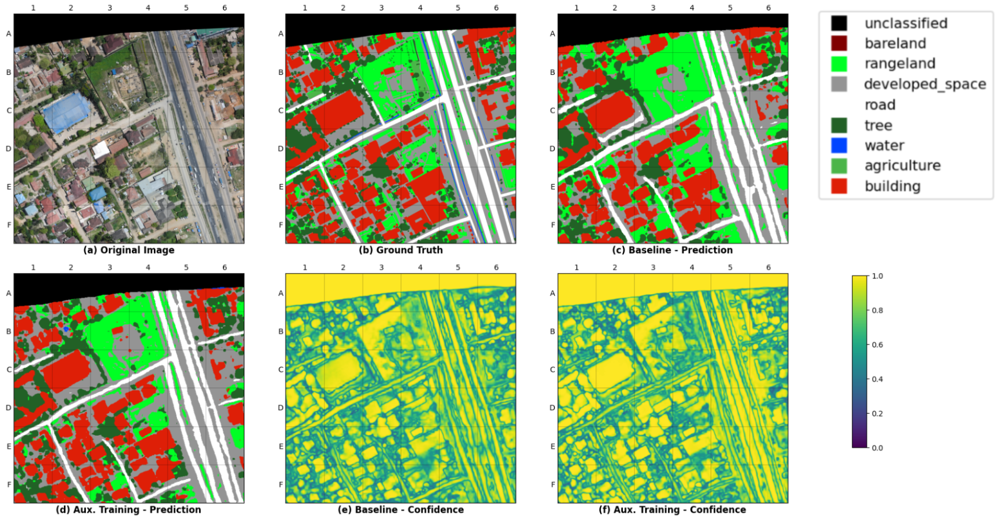

# SAM2-UNet with OpenStreetMap auxiliary supervision

This repository contains the training and evaluation code for the EPIA 2026 paper on high-resolution land use / land cover semantic segmentation: "Adapting SAM2-UNet for High-Resolution LULC Semantic Segmentation with OpenStreetMap Auxiliary Supervision". The model is a dual-decoder adaptation of SAM2-UNet trained on OpenEarthMap. During training, two auxiliary branches are supervised with OpenStreetMap-derived road and building masks as distance-transform soft targets (MSE loss, lambda_road = 0.5, lambda_building = 0.25, d = 6). At inference time the auxiliary branches are dropped, so the model runs on RGB imagery only.

## Repository contents

```
├── src/
│   ├── __init__.py
│   ├── model.py        # DualDecoder_SAM2UNet: frozen SAM2 encoder, adapters, RFB blocks, dual decoders
│   ├── dataset.py      # OpenEarthMap tiles + OSM road/building mask loading and augmentation
│   ├── metrics.py      # mIoU, precision/recall, F1, per-class IoU, Boundary IoU
├── scripts/
│   ├── train_paper_models.py   # Baseline + auxiliary training runs over multiple seeds
│   ├── aggregate_metrics.py    # Mean/std over seed metrics JSONs (produces the results table)
│   └── plot_results.py         # Renders the test comparison chart from the metric JSONs
├── notebooks/          # Original Kaggle notebooks used for the reported experiments
├── figures/            # Figures referenced below
└── results/
    ├── history/        # Per-seed test metrics (seeds 42, 43, 44)
    └── test_comparison.png
```

The modules in `src/` and `scripts/` are taken from the notebooks (only the Kaggle-specific paths were adapted for local use), so the released code matches what was actually run. The figure below shows how rasterised OSM road masks align with the OpenEarthMap annotations.



## Notebooks

- `notebooks/train_paper_models_seeds42-44.ipynb` trains all five configurations (baseline, roads only at lambda 0.5, roads+buildings at lambda_building 0.25/0.50/0.75) over seeds 42, 43 and 44. It writes one `{run}_seed{seed}_metrics.json` file per run; Kaggle's session limit means each seed was run in its own session.
- `notebooks/dt_ablation_lambda0p5_d3-6-10.ipynb` contains the distance-transform ablation on the validation split (d = 3, 6, 10 at lambda 0.5), plus the no-OSM baseline.

## Setup

```bash
pip install -r requirements.txt
pip install git+https://github.com/facebookresearch/sam2.git
```

You also need:

- The OpenEarthMap dataset (without xBD subset), organised as `<city>/images/*.tif` and `<city>/labels/*.tif`
- Fixed `train.txt`, `val.txt`, `test.txt` split files (1879 / 404 / 404 tiles)
- The SAM2 tiny checkpoint (`sam2_hiera_tiny.pt`) from the [SAM2 releases](https://github.com/facebookresearch/sam2)
- Rasterised OSM road and building binary masks aligned to the tiles (optional, needed only for the auxiliary runs)

## Training

```bash
python scripts/train_paper_models.py \
    --data-root /path/to/OpenEarthMap_wo_xBD \
    --train-txt train.txt --val-txt val.txt --test-txt test.txt \
    --osm-roads-dir /path/to/osm/roads/binary_masks \
    --osm-buildings-dir /path/to/osm/buildings/binary_masks \
    --sam-checkpoints-dir /path/to/sam-checkpoints \
    --seeds 42 43 44
```

Training uses AdamW (lr 1e-3, weight decay 5e-4), a cosine schedule, batch size 4 on 512x512 tiles, mixed precision, and early stopping on validation mIoU. Each run's best checkpoint is saved under `outputs/`, and its test metrics under `history/`.

## Results

OpenEarthMap test split, mean +/- std over seeds 42, 43, 44:

| Model | mIoU | F1 | Boundary mIoU |
|---|---|---|---|
| Baseline SAM2-UNet | 0.6545 +/- 0.0101 | 0.7811 +/- 0.0075 | 0.5643 +/- 0.0132 |
| OSM Auxiliary DT (Roads Only) | **0.6594 +/- 0.0074** | **0.7846 +/- 0.0049** | **0.5698 +/- 0.0095** |
| OSM Auxiliary DT (Roads+Buildings) | 0.6536 +/- 0.0076 | 0.7797 +/- 0.0070 | 0.5675 +/- 0.0065 |

To reproduce these numbers from the metric files:

```bash
cd results && python ../scripts/aggregate_metrics.py
```

To regenerate the comparison chart:

```bash
python scripts/plot_results.py
```



Distance-transform ablation (validation split): the d=6 setting gives the best validation behaviour (mIoU 0.6777, Boundary mIoU 0.5727, Road IoU 0.5777) compared with d=3, d=10, and the no-OSM baseline. See the ablation notebook for full outputs.

Auxiliary supervision mainly helps boundary quality on thin structures such as roads. The qualitative figure below contrasts baseline predictions with the roads-only auxiliary model.


